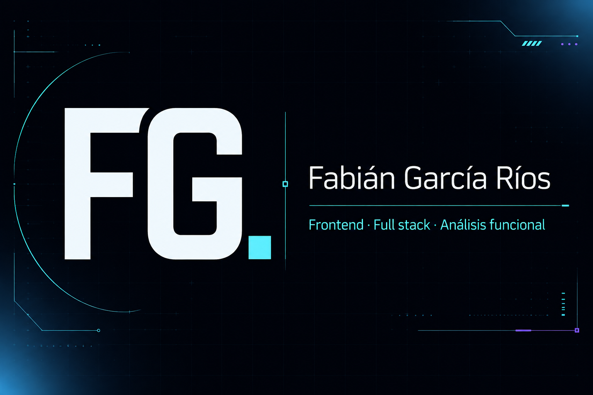

# FG. · Portafolio de Fabián García Ríos

Portafolio profesional de Fabián García Ríos, Técnico en Computación e Informática con mención en Programación, enfocado en desarrollo frontend, full stack y análisis funcional.

[Ver portafolio publicado](https://darouji.github.io/)



## Proyectos

- **Nexo ERP/CRM:** caso de estudio anonimizado de un MVP para conectar inventario, compras, ventas, contactos y trazabilidad. El código y la documentación originales no se publican por precaución respecto de datos, confidencialidad y titularidad.
- **Clarity Software:** prototipo académico en Flutter y Firebase. [Ver repositorio](https://github.com/Darouji/Clarity_Software).

## Desarrollo local

```sh
npm ci
npm run dev
```

Para generar la versión estática:

```sh
npm run build
```

El contenido de producción se genera en `dist/client` y GitHub Actions lo publica automáticamente en GitHub Pages.

## Privacidad

Las vistas de proyectos son representaciones conceptuales con datos ficticios. Este repositorio no contiene código, documentos, marcas ni datos pertenecientes a las organizaciones relacionadas con experiencias anteriores.